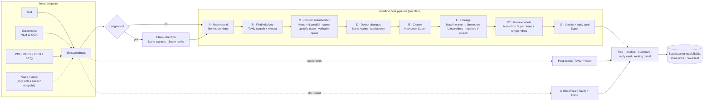

# Rootline

**See where it really came from before you forward it.**

Rootline traces where a viral claim came from and how it changed as it spread. Give it a forwarded message, a screenshot of a post or a document. It finds earlier and parallel versions across the web, builds a family tree of those versions, shows the detected changes between copies (a number inflated, a fake authority added, urgency added…), points to the earliest version it found, and writes a calm reply card you can send back to the group chat.

Built for the **Nebius × NVIDIA Global AI Hackathon** (track: Best Apps and Agents; also targeting Best Use of Tavily). Inference runs on **NVIDIA Nemotron** models through any OpenAI-compatible endpoint; **Nebius Token Factory is the default and the target deployment**.

> Docs: [`docs/PROGRESS.md`](docs/PROGRESS.md) (status, real-data results, label accuracy) · [`docs/TEAMMATE_DEPLOY.md`](docs/TEAMMATE_DEPLOY.md) (deploy on Nebius) · [`docs/DEPLOY_VERCEL_NVIDIA.md`](docs/DEPLOY_VERCEL_NVIDIA.md) (Vercel on the NVIDIA API) · [`docs/FEEDBACK.md`](docs/FEEDBACK.md) · [`docs/DEMO_SCRIPT.md`](docs/DEMO_SCRIPT.md) · [`docs/SUBMISSION.md`](docs/SUBMISSION.md)

## Why

Forwarded misinformation causes scams, panic and violence, especially in Nigeria, India and Brazil. It spreads as text forwards, screenshots and fake "official" circulars. A fact-check says *false*; it rarely shows *how a harmless 2001 email about mailed perfume samples became "men at filling stations are kidnapping women"*. Seeing the mutation is what makes people stop forwarding.

Two audiences: **people receiving forwards** (mobile-first UI, a reply card, "Share to WhatsApp") and **organizations that track facts** (documents, a Watchlist that re-runs investigations to catch new versions, shareable result pages).

## What it does

| Input | How it's read | Extra check |
|---|---|---|
| Pasted text | normalized (forwarding junk, chat formatting, emoji noise stripped) | none |
| Screenshot (PNG/JPG/WebP, several at once, paste from clipboard) | vision-language model if `MODEL_VISION` is set, else Tesseract.js OCR → Nano cleanup | **Does this post actually exist?** |
| PDF / DOCX (≤ 15 MB) | pdf.js text layer (scanned pages → vision/OCR), mammoth | **Is this official?** + claim selection |
| XLSX / PPTX | SheetJS labeled cells + notes; slide text + speaker notes | claim selection |
| Voice notes and video | **available when a speech endpoint is configured** (`ASR_ENDPOINT_URL`); hidden otherwise | claim selection |

> **Voice notes and video are a feature flag, OFF by default.** They appear only when `ASR_ENDPOINT_URL` points at an OpenAI-compatible speech-to-text endpoint, and that code path has **not been tested** against a real endpoint (the ffmpeg/keyframe plumbing is unit-level only). Treat it as experimental.

**General statements are not traced.** Rootline traces how *messages* spread. A new Stage A0 classifies pasted text as a *circulating message* (chain forward, viral post, hoax-style warning, scam offer, a claim with distinctive wording) or a *general statement about current events*. For a general statement Rootline builds **no lineage tree and implies no doubt**: it says "This looks like a general statement about current events, not a forwarded message…" and lists 3–5 reputable news/official/research sources found with Tavily, each with a one-line neutral summary and a link. The reply card stays neutral. A clear chain-forward marker (a call to share/forward, urgent-warning wording) always wins over the model, so real forwards are never downgraded; screenshots and documents are always treated as messages.

Every input becomes one `ExtractedInput` object, then runs through the same pipeline:



Progress streams to the browser over server-sent events at every stage and the tree grows node by node.

## How the models are used

All model calls go through `src/lib/llm.ts`, an OpenAI-compatible client (`/v1/chat/completions`) pointed at **Nebius Token Factory by default**. Every output is validated with **Zod**; malformed JSON is retried once with a bigger output budget, then the stage degrades to a rule-based fallback (logged as such). Every call (provider, model, stage, tokens in/out, latency) is logged and shown in the **"How this was built"** drawer.

| Tier | Env | Jobs | Why |
|---|---|---|---|
| **Nemotron Nano** class | `MODEL_NANO` | claim parsing + search planning (A), page membership with a verbatim quote (C, parallel), pairwise change detection (D, parallel), post-exists and official checks, OCR cleanup, claim extraction | Dozens of small structured calls per run: cheap and fast enough to fan out with `p-limit` |
| **Nemotron Super** class | `MODEL_SUPER` | clustering variants into branches (E), **reviewing every change label against the exact parent/child text (D2: keep / retype / drop only, never add)**, ranking claims, the verdict and reply card (G) | Judgement across many items, and careful, kind writing |
| **Nemotron Ultra** | `MODEL_ULTRA` | refining the lineage tree (F) | One hard reasoning call per claim. Ultra may not add nodes; its tree is validated (ids exist, one root, no cycles, no parent dated after its child) and *repaired* edge by edge from the baseline tree if invalid |
| Vision-language model | `MODEL_VISION` (optional) | screenshots, scanned PDF pages | Reads layout (handle, timestamp, engagement). Falls back to Tesseract.js OCR |

Nemotron 3.x models "think" by default; Rootline sends `chat_template_kwargs: {"enable_thinking": false}` for structured stages and automatically drops that parameter (or JSON mode) per model if the provider rejects it with HTTP 400. Requests are throttled and retried on 429/5xx.

The routing drawer computes real cost from logged tokens and Token Factory list prices (labelled an estimate on other providers) and compares it with re-pricing the same calls at Ultra rates.

### Switching LLM providers (environment variables only)

Nothing in the code is provider-specific beyond display labels and a default rate limit. The provider shown for a run is read from that run's own call log.

| | Nebius Token Factory (default) | NVIDIA API (used while developing) |
|---|---|---|
| `LLM_BASE_URL` | `https://api.tokenfactory.nebius.com/v1` | `https://integrate.api.nvidia.com/v1` |
| `LLM_API_KEY` | Token Factory key | `nvapi-…` key |
| `MODEL_NANO` | `nvidia/Nemotron-3_5-Lightning` | `nvidia/nemotron-3.5-lightning-30b-a3b` |
| `MODEL_SUPER` | `nvidia/nemotron-3-super-120b-a12b` | `nvidia/nemotron-3.5-super-vl-120b-a12b` |
| `MODEL_ULTRA` | `nvidia/Nemotron-3-Ultra-550b-a55b` | `nvidia/nemotron-3-ultra-550b-a55b` |
| `MODEL_VISION` | find with `npm run verify-nebius` | `nvidia/nemotron-3.5-super-vl-120b-a12b` |

- **The Nebius IDs come from Nebius' cookbook and were not tested by us** (our account was blocked by a billing-country restriction). `npm run verify-nebius` checks them against your key.
- `npm run probe` tries every model on your key: providers list models that a key cannot call (we saw `404 Function not found for account` on NVIDIA).
- `LLM_RPM` throttles all calls (default 30/min on the NVIDIA API, unlimited elsewhere).

## How Tavily is used

- **Search** (`include_published_date`) runs 4–8 queries per claim: verbatim distinctive phrases plus paraphrases; results are deduplicated and ranked by how many queries found each page.
- **Extract** (batches of 20) fetches page text so Nano can quote the message verbatim.
- **Post-exists** and **is-this-official** checks search the post text with handle/name, or the issuing organization, the reference number and a fact-check query (including a government-domain pass).
- **Dates:** Tavily's `published_date` → `published_date`; a date in the page text → `page_metadata`; else `unknown`. (Tavily says `published_date` can be a last-updated date; it is labelled "reported by the source".)
- Budgets: `MAX_QUERIES`, `MAX_CANDIDATE_PAGES` (40), `MAX_PAIRS` (80). A fresh trace costs roughly 16–20 credits.

## Honesty rules (enforced in code)

- **Never invent a variant, source, date or quote.** Every node links to a real URL (or your upload). Quotes are built from numbered sentences of the page, so they are verbatim by construction, and are re-checked against the page text.
- **A page is a "version" only if it is about the same specific claim.** The model must say so; a money offer needs an amount in the same currency; a claim naming an organisation needs the whole distinctive name on the page; a fact-check, news or official page must speak to the claim's specifics (a fact-check of a *different* video or story on the same topic does not attach); and the page must read like a circulating message, not a topic explainer.
- **Neutral by default; stricter on sensitive topics.** A reply card never suggests a claim is false or doubtful unless a listed source directly contradicts that exact claim. On ethnic, religious, conflict or security topics the generated text stays strictly factual and attributed, and a social/forum post is never presented as the "earliest version".
- **Changes are detected only between copies of the message.** On fact-check, news and official pages the node text is only the rumor *as quoted verbatim*, never the article's commentary. A page without a clean quoted copy stays as a dated **evidence page** with no changes labelled on its edges.
- **"Detected changes", strong first.** Every label must appear in the parent/child text and fit its type, then a Super review pass may keep, retype or drop it (never add). Only strong labels show by default; weaker ones sit behind a "Show weaker changes" toggle. Measured accuracy is in `docs/PROGRESS.md`: a detector, not a verdict.
- **No padding.** Fewer than 3 relatives → a designed "Limited family found" state.
- **Date provenance everywhere:** `published_date`, `page_metadata`, `from_screenshot_unverified`, `pdf_metadata_unverified`, `unknown`. Screenshot timestamps are never used to order the tree.
- **Edges are inferences:** confidence (capped by wording similarity) and "earliest version found", never "origin". "Wider spread" is flagged only with at least 3 dated later sources.
- **Never "definitely fake":** `not_found` → "No evidence this post exists"; `no_official_record_found` → "Verify directly with the organization before acting". A source is cited as contradicting a statement only if it speaks to that statement's specifics.
- Rootline traces **what is said**, not whether media is authentic. No deepfake claims.
- Uploaded files are deleted after reading; only extracted text, a small screenshot thumbnail and results are stored. Phone numbers and emails are redacted from screenshot text.
- Demo source files use clearly fictional people, accounts and organizations.

## Setup

Node 20+ (22 recommended); ffmpeg is bundled via `ffmpeg-static` (only used by the experimental video path).

```bash
npm install
cp .env.example .env.local     # fill in keys (see "Switching LLM providers")
npm run probe                  # which models can your key actually call?
npm run dev                    # http://localhost:3000
```

No keys yet? The example chips replay the saved real runs in `/fixtures` (no network needed). `OFFLINE_MOCK=true npm run dev` runs the live pipeline against a **fictional** built-in corpus (`.example` domains) for development and tests only.

### Demo fixtures

`/fixtures/*.json` are saved **real** runs (real Tavily search plus whichever provider was configured when they were generated): a perfume-sample forward, a screenshot of a post from a fictional account, the WhatsApp "Martinelli" warning, a fake circular from a fictional organization, and a general news statement (no tree, reputable reports only). The app states which provider produced each one, read from the run's own call log. Regenerate on whatever provider is configured:

```bash
npm run fixtures                 # all five (about 80 Tavily credits)
npm run fixtures -- martinelli   # one
```

There is no offline mode for fixtures: a fixture must come from a real run.

### Scripts

| | |
|---|---|
| `npm run dev` / `build` / `start` | Next.js |
| `npm test` · `lint` · `typecheck` | Vitest · ESLint · `tsc --noEmit` |
| `npm run verify-nebius` | PASS/FAIL checklist: config, `/v1/models`, a request to every model, one real end-to-end trace |
| `npm run probe` | tiny request to every model on your key |
| `npm run models` | list Nemotron models on the configured provider and suggest `MODEL_*` |
| `npm run fixtures` | regenerate the demo fixtures from real runs |
| `npm run eval` | node counts, edge confidence, latency and cost per fixture |
| `npm run real-test` | run real rumors end to end and audit them (verbatim quotes, grounded labels, cost); uses `DEV_CACHE` |
| `npm run compare-nano -- <rumor> <modelA> <modelB>` | compare Nano-tier candidates on the membership stage |

`DEV_CACHE=true` caches Tavily and LLM responses in `.cache/` (never on Vercel).

### Environment variables

Everything the code reads is in [`.env.example`](.env.example): `LLM_BASE_URL`, `LLM_API_KEY`, `MODEL_NANO|SUPER|ULTRA|VISION`, `TAVILY_API_KEY`, optional `NEXT_PUBLIC_SUPABASE_URL` + `SUPABASE_SERVICE_ROLE_KEY`, `DEMO_MODE`, `ASR_ENDPOINT_URL`/`MODEL_ASR`/`ASR_API_KEY` (speech feature flag), budgets (`MAX_*`, `MODEL_CONCURRENCY`, `LLM_RPM`), `PRICE_*` and a few dev switches. All keys stay server-side. The older `NEBIUS_API_KEY`/`NEBIUS_BASE_URL` names still work as fallbacks.

### Supabase (optional)

Run [`supabase/schema.sql`](supabase/schema.sql), then set `NEXT_PUBLIC_SUPABASE_URL` and `SUPABASE_SERVICE_ROLE_KEY` (used only in server routes; Row Level Security blocks the public anon key). Without them, results and the Watchlist are stored as JSON in `.data/` (or `/tmp` on Vercel, which is ephemeral).

### Deploy (Vercel)

Step by step: [`docs/TEAMMATE_DEPLOY.md`](docs/TEAMMATE_DEPLOY.md) (Nebius) and [`docs/DEPLOY_VERCEL_NVIDIA.md`](docs/DEPLOY_VERCEL_NVIDIA.md) (NVIDIA API). Route handlers use the Node.js runtime with `maxDuration = 300`.

## Limitations

- Lineage is inferred from what is publicly indexed. Private WhatsApp chains are invisible; the earliest version *found* is not necessarily the origin.
- Search dates can be last-updated dates; undated pages are placed by wording only.
- Detected-change labels are imperfect (see measured accuracy in `docs/PROGRESS.md`); Rootline never adds labels the detector didn't find, so real changes can be missed.
- Voice notes and video are experimental and untested (feature flag).
- Not tested on Nebius Token Factory by the authors (see `docs/TEAMMATE_DEPLOY.md`).
- Rate limiting is per-instance and best-effort; there is no authentication, so the Watchlist is shared by everyone using a deployment.

## License

[MIT](LICENSE)
