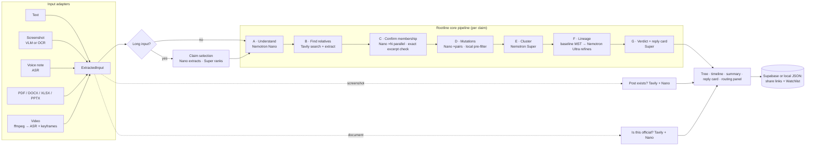

# Rootline

**See where it really came from before you forward it.**

Rootline traces where a viral claim came from and how it mutated as it spread. Give it a forwarded message, a screenshot of a post, a voice note, a video or a document. It finds earlier and parallel versions across the web, builds a family tree of those versions, labels every mutation between parent and child (a number inflated, a place swapped, a fake authority added, urgency added…), shows the earliest version found, and gives you a calm reply card to send back to the group chat.

Built for the **Nebius × NVIDIA Global AI Hackathon** (track: Best Apps and Agents; also targeting Best Use of Tavily). All AI inference runs on **Nebius Token Factory** with **NVIDIA Nemotron** models.

> Status, what's done and what was cut: [`docs/PROGRESS.md`](docs/PROGRESS.md)

## Why

Forwarded misinformation causes scams, panic and violence, especially in Nigeria, India and Brazil. It spreads as text forwards, screenshots, voice notes (often in Pidgin, Yoruba, Igbo or Hausa) and fake "official" circulars. A fact-check says *false*; it rarely shows *how a harmless 2017 forum post became "2,000 women missing, police confirmed"*. Seeing the mutation is what makes people stop forwarding.

Two audiences:

- **People receiving forwards**, often on a phone, straight from WhatsApp. Mobile-first UI, a reply card and a "Share to WhatsApp" button.
- **Organizations that track facts** (newsrooms, fact-checkers, NGOs, comms teams). Documents, decks and spreadsheets in, a Watchlist that re-runs investigations to catch new mutations, and shareable result pages.

## What it does

| Input | How it's read | Extra check |
|---|---|---|
| Pasted text | normalized (forwarding junk, chat formatting, emoji noise stripped) | — |
| Screenshot (PNG/JPG/WebP, multiple, paste from clipboard) | NVIDIA VLM on Token Factory (`MODEL_VISION`), else Tesseract.js OCR → Nano cleanup | **Does this post actually exist?** |
| Voice note (mp3, m4a, ogg/opus, wav; ≤10 min) | ASR provider interface (Token Factory speech model → OpenAI-compatible ASR endpoint on Nebius) → Nano cleanup + English translation | — |
| PDF / DOCX (≤15 MB) | pdf.js text layer (scanned pages → vision/OCR), mammoth | **Is this official?** + claim selection |
| Video (mp4/mov/webm; ≤3 min) | ffmpeg → audio via ASR + 1 keyframe / 5 s via vision/OCR | claim selection |
| XLSX / PPTX | SheetJS (labeled cells, notes), OOXML slide + speaker-note text | claim selection |

Every input becomes the same `ExtractedInput` object, then runs through one shared pipeline:



Progress streams to the browser over server-sent events at every stage ("Reading screenshot…", "Searching… 6/8 queries · 23 sources", "Comparing 14 pairs…", "Building lineage…"), and the tree grows node by node.

## How Nemotron, Token Factory and NVIDIA models are used

All model calls go through `src/lib/llm.ts`, an OpenAI-compatible client (`/v1/chat/completions`) pointed at **Nebius Token Factory by default**. Every output is validated with **Zod**; malformed JSON is retried once with the validation error fed back, then the stage **degrades gracefully** to a deterministic fallback (logged as such). Every call — provider, model, stage, tokens in/out, latency — is logged and shown in the **"How this was built"** routing panel.

Each tier does the job it is best value for:

| Tier | Model (env) | Jobs | Why this tier |
|---|---|---|---|
| **Nemotron Nano** | `MODEL_NANO` | claim parsing + search planning (A), page membership with exact excerpts (C, parallel), pairwise mutation labelling (D, parallel), post-exists and official checks, OCR/transcript cleanup + translation, claim extraction | Dozens of small, narrow, structured calls per run. Nano is ~17× cheaper than Ultra per output token and fast enough to fan out with `p-limit`. |
| **Nemotron Super** | `MODEL_SUPER` | clustering variants into branches (E), ranking claims by checkability × significance, the verdict and reply card (G) | Judgement across many items at once, and careful, kind writing, at moderate cost. |
| **Nemotron Ultra** | `MODEL_ULTRA` | refining the whole lineage tree (F) | One hard reasoning call per claim: weigh dates, wording distance and mutation inheritance under hard constraints. Ultra may **not add nodes**; its tree is validated (ids exist, one root, no cycles, no parent later than child) or the algorithmic baseline is kept. |
| **NVIDIA VLM** | `MODEL_VISION` | reading screenshots, scanned PDF pages and video keyframes | Reads layout (handle, timestamp, engagement) as well as text. Falls back to Tesseract.js OCR + Nano cleanup. |
| **NVIDIA speech** | `MODEL_ASR` / `ASR_ENDPOINT_URL` | voice notes, video audio | Parakeet / Canary when available; any OpenAI-compatible Whisper endpoint as fallback. |

The routing panel computes a real cost from the logged token counts and Token Factory list prices, and compares it with re-pricing the same calls at Ultra rates (with an explicitly estimated latency).

Nemotron 3 models reason by default; for structured stages Rootline sends `chat_template_kwargs: {"enable_thinking": false}` (and automatically retries without it if a model rejects the parameter), and strips any `<think>` blocks before parsing.

### Switching LLM providers (env only)

The provider is configured entirely by environment variables, so the same build runs on Nebius Token Factory or on NVIDIA's API at [build.nvidia.com](https://build.nvidia.com) (same Nemotron family) without code changes:

| | Nebius Token Factory (default) | NVIDIA API (development) |
|---|---|---|
| `LLM_BASE_URL` | `https://api.tokenfactory.nebius.com/v1` | `https://integrate.api.nvidia.com/v1` |
| `LLM_API_KEY` | Token Factory key | `nvapi-…` key |
| `MODEL_NANO` | `nvidia/nvidia-nemotron-3-nano-30b-a3b` | `nvidia/nemotron-nano-3-30b-a3b` |
| `MODEL_SUPER` | `nvidia/nemotron-3-super-120b-a12b` | `nvidia/nemotron-3-super-120b-a12b` |
| `MODEL_ULTRA` | `nvidia/Nemotron-3-Ultra-550b-a55b` | `nvidia/nemotron-3-ultra-550b-a55b` |
| `MODEL_VISION` | verify with `npm run models` | `nvidia/nemotron-3.5-super-vl-120b-a12b` |

- `npm run models` lists the Nemotron/NVIDIA models on whichever `LLM_BASE_URL` is set and suggests `MODEL_*` values.
- The provider label (`nebius` / `nvidia` / `openai-compatible`) is inferred from the URL (or `LLM_PROVIDER`) and shown in the routing panel and call log.
- Providers differ in which optional parameters they accept. If a model returns HTTP 400 for `chat_template_kwargs` (the thinking toggle) or `response_format` (JSON mode), the client drops that parameter, remembers it for that model, and retries. JSON is Zod-validated either way.
- Cost in the routing panel uses Token Factory list prices; on another provider it is labelled as an estimate. Override with `PRICE_*`.
- The older `NEBIUS_API_KEY` / `NEBIUS_BASE_URL` / `NEBIUS_VISION_BASE_URL` names still work; `LLM_*` wins when both are set.
- NVIDIA's speech models (Parakeet/Canary) on build.nvidia.com use Riva gRPC, not the OpenAI audio API, so voice notes still need `ASR_ENDPOINT_URL` (below).

### Speech on Nebius (deploying Parakeet / Whisper)

Token Factory's docs list chat completions but no `/audio/transcriptions` endpoint (see `docs/FEEDBACK.md`). Rootline's ASR interface therefore supports, in order:

1. `MODEL_ASR` on Token Factory, sent as an OpenAI-style `input_audio` part (for audio-capable models).
2. `ASR_ENDPOINT_URL`: any OpenAI-compatible `/v1/audio/transcriptions` server. To run NVIDIA Parakeet on **Nebius Serverless / AI Cloud**: deploy the NVIDIA Riva ASR NIM container (e.g. `nvcr.io/nim/nvidia/parakeet-ctc-1.1b-asr`, needs an NGC key) on a GPU endpoint exposing port 9000, then set `ASR_ENDPOINT_URL=https://<endpoint>`, `MODEL_ASR=<model name>`. The same works with an open-source Whisper server (e.g. `speaches` / `faster-whisper-server`) as the fallback.
3. Neither configured → the UI asks the user to type what the voice note says.

## How Tavily is used

Tavily is the search backbone (`src/lib/search.ts`):

- **Search** (`/search`, `include_published_date: true`) runs 4–8 queries per claim — verbatim distinctive phrases in quotes plus paraphrases (mutated copies reword things), in the original language and English for voice notes — deduplicated by URL and ranked by how many queries found each page.
- **Extract** (`/extract`, batches of 20, `query`-reranked chunks) fetches page text so Nano can confirm membership and quote the **exact** excerpt.
- **Post-exists check**: searches the post text with the handle and display name, also restricted to the platform's domains (`include_domains`).
- **Is-this-official check**: searches the issuing organization + subject, the reference number, a fact-check query, and a pass restricted to government domains (`gov.ng`, `gov`, …).
- **Dates**: Tavily's `published_date` → `published_date` provenance; otherwise a date found in the page text → `page_metadata`; otherwise `unknown`. (Tavily notes `published_date` can be a last-updated date; it is labelled as reported by the source.)
- Budgets: `MAX_QUERIES`, `MAX_CANDIDATE_PAGES` (40), `MAX_PAIRS` (80).

## Honesty rules (enforced in code)

- **Never invent a variant, source, date or quote.** Every node links to a real source URL (or your upload). A model's excerpt is accepted only if it actually appears in the page text (`excerptAppearsIn`); otherwise the verbatim best-matching passage is used or the page is rejected.
- **No padding.** Fewer than 3 relatives → a designed **"Limited family found"** state.
- **Date provenance everywhere**: `published_date`, `page_metadata`, `from_screenshot_unverified`, `pdf_metadata_unverified`, `unknown`. Screenshot timestamps are shown but never used to order the tree.
- **Edges are inferences**: confidence (low/medium/high, dashed = low), "likely lineage", "earliest version found" — never "origin".
- **Never "definitely fake"**: defined outcomes only (`not_found` → "No evidence this post exists", `no_official_record_found` → "Verify directly with the organization before acting").
- Only statements a found source contradicts are marked unsupported, with links — URLs not in the evidence are dropped.
- Rootline traces **what is said**, not whether media is authentic. No deepfake/manipulation claims.
- Uploaded media is deleted after extraction (temp dirs are always removed); only extracted text, a small screenshot thumbnail and results are stored. Phone numbers and emails are redacted from screenshot text.
- Demo fixtures use clearly fictional people, accounts and organizations.

## Setup

Requirements: Node 20+ (22 recommended). `ffmpeg` is bundled via `ffmpeg-static`.

```bash
npm install
cp .env.example .env.local   # fill in keys
npm run models               # lists Nemotron/NVIDIA models on LLM_BASE_URL and suggests MODEL_* values
npm run dev                  # http://localhost:3000
```

No keys yet? Two ways to see it work:

```bash
npm run dev                  # example chips replay the saved runs in /fixtures
OFFLINE_MOCK=true npm run dev  # live pipeline against a FICTIONAL built-in corpus (.example domains)
```

### Environment variables

See [`.env.example`](.env.example). Key ones: `LLM_BASE_URL`, `LLM_API_KEY`, `MODEL_NANO|SUPER|ULTRA|VISION|ASR`, `ASR_ENDPOINT_URL`, `TAVILY_API_KEY`, `NEXT_PUBLIC_SUPABASE_URL`, `SUPABASE_SERVICE_ROLE_KEY`, `DEMO_MODE`, `OFFLINE_MOCK`. All keys stay server-side.

### Supabase (optional)

Run [`supabase/schema.sql`](supabase/schema.sql) in the SQL editor, then set `NEXT_PUBLIC_SUPABASE_URL` and `SUPABASE_SERVICE_ROLE_KEY`. Without them, investigations and the Watchlist are stored as JSON in `.data/` (or `/tmp` on Vercel, which is ephemeral).

### Demo mode and fixtures

- `/fixtures/*.json` are full saved runs (variants, edges, checks and routing logs). Example chips always replay them with realistic streamed timing, labelled **"Replay of a saved run."** With `DEMO_MODE=true`, pasting a demo message also replays.
- Regenerate: `npm run fixtures` (uses the live pipeline when `LLM_API_KEY`, `MODEL_NANO` and `TAVILY_API_KEY` are set; otherwise the offline mock — and the fixture says so in the UI).
- Source files: `fixtures/files` (regenerate with `scripts/make-fixture-files.sh`).
- `npm run eval` prints node counts, edge confidence, latency and cost for every fixture (`--rerun` to run them again).

### Scripts

| | |
|---|---|
| `npm run dev` / `build` / `start` | Next.js |
| `npm test` | Vitest unit + integration tests (normalization, dedup, tree + date constraint, Zod schemas, every parser incl. a scanned PDF, adapters, offline end-to-end pipeline) |
| `npm run lint` / `typecheck` | ESLint / `tsc --noEmit` |
| `npm run fixtures` | regenerate demo fixtures |
| `npm run eval` | fixture metrics |
| `npm run models` | list Nemotron/NVIDIA models on the configured provider |

### Deploy (Vercel)

```bash
npx vercel link
npx vercel env add LLM_API_KEY           # repeat for each variable in .env.example
npx vercel --prod
```

Route handlers use the Node.js runtime with `maxDuration = 300`. ffmpeg-static, Tesseract.js and pdf.js are kept external and traced into the functions (`next.config.ts`). Long videos may exceed serverless limits; see limitations.

## Limitations

- Lineage is inferred from what is publicly indexed. Private WhatsApp chains are invisible; the earliest version *found* is not necessarily the origin.
- Search-reported dates can be last-updated dates; undated pages are placed by wording only.
- OCR/ASR errors propagate (the review step lets users fix them); Pidgin and other local languages are harder for ASR.
- Video processing on Vercel is bounded by function duration and memory; for heavier media, run the same adapter code on a Nebius endpoint (documented in `docs/PROGRESS.md`).
- Rate limiting is per-instance and best-effort.
- No authentication: the Watchlist is shared by everyone using a deployment.

## License

[MIT](LICENSE)
